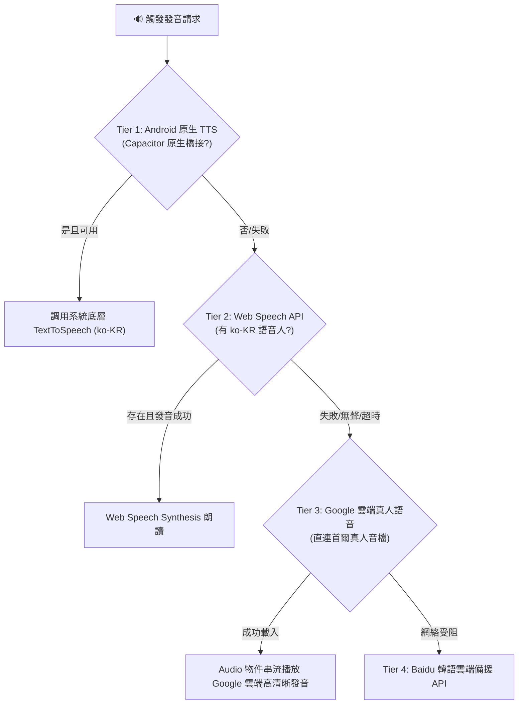
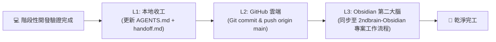

# 🛡️ KITTY 韓語發音積木樂園 • 全技術架構排錯防禦與避坑實戰指南
> **KITTY Korean Learning Playground: Comprehensive Troubleshooting & Anti-Pitfall Engineering Guide**
> 
> 本手冊彙整專案自誕生以來的**所有核心踩坑紀錄、底層原理深度剖析、防禦型代碼模式與避坑黃金守則**。涵蓋韓語語法引擎、語音 TTS/STT 雙軌通訊、Android 原生容器、前端工程架構、正體中文標準化與多端發布同步等 8 大核心領域。

---

## 📑 目錄導覽

- [一、韓語語法引擎與語幹變形踩坑 (Hangul Engine & Morphological Pitfalls)](#一韓語語法引擎與語幹變形踩坑)
- [二、S-P-O-V 語法螢光筆透視與智慧分詞踩坑 (Syntax Highlighter & Smart Tokenizer)](#二s-p-o-v-語法螢光筆透視與智慧分詞踩坑)
- [三、語音播放 (TTS) 四級高可用容錯架構 (Audio & KittyVoice Engine)](#三語音播放-tts-四級高可用容錯架構)
- [四、語音辨識 (STT) 雙軌原生橋接踩坑 (KittySTT & Android Native Bridge)](#四語音辨識-stt-雙軌原生橋接踩坑)
- [五、前端工程與 React / Babel 避坑 (Frontend & Runtime Architecture)](#五前端工程與-react--babel-避坑)
- [六、繁體中文正字標準與資料清洗防護 (Localization & OpenCC s2twp)](#六繁體中文正字標準與資料清洗防護)
- [七、多端同步與 Firebase / Capacitor 發布規範 (Multi-Platform & Deployment)](#七多端同步與-firebase--capacitor-發布規範)
- [八、三層級自動化收工與第二大腦知識沉澱 (Three-Tier Sync Architecture)](#八三層級自動化收工與第二大腦知識沉澱)

---

## 一、韓語語法引擎與語幹變形踩坑

### 1.1 名詞謂語句 (體言 Copula `이다 / 이에요 / 예요`) 誤拆為動詞/地點

#### 💥 踩坑現象
當使用者在造句火車輸入名詞謂語句（如 `엄마는 선생님이에요`），系統竟將 `선생님` 當作一般動詞詞幹處理：
- 日常敬語輸出為：`선생님어 [요.]` ❌
- 螢光筆透視誤拆為：`선생님이` (主語) + `[에]` (地點) + `어` (動詞) + `[요.]` ❌
- 中文翻譯合成輸出為：`媽媽 老師。`（缺漏「是」字）❌

#### 🔬 底層原因
1. 韓語動詞常規變形（如 `먹다` ➔ `먹어요`）依賴最後一個音節的母音（陽性 `ㅏ/ㅗ` 接 `아요`，陰性母音接 `어요`）。
2. `선생님` 最後一個字是 `님`，其母音為 `ㅣ`（陰性母音），若無指定詞判定，引擎誤將其作為動詞詞幹直接加上 `어요`，導致 `선생님` + `어요` ➔ `선생님어` + `요.` 的荒謬語病。
3. 韓語「體言（名詞）+ 指定詞（`이다`）」本質不是動詞，具有專屬的收音接續與口語縮合規則。

#### 💡 避坑與解決方案
建立獨立的名詞繫詞解析器 `resolveVerbObject` 與專屬變形矩陣：
```javascript
// 1. 名詞繫詞解析器 (精準截取名詞體言)
if (t.endsWith("이에요") && t.length >= 4) {
    const noun = t.slice(0, -3);
    return { kr: noun + "이다", stem: noun, noun, isCopula: true, zh: "是" + noun, isQuestion };
}
if (t.endsWith("예요") && t.length >= 3) {
    const noun = t.slice(0, -2);
    return { kr: noun + "이다", stem: noun, noun, isCopula: true, zh: "是" + noun, isQuestion };
}
// 若使用者在動詞車廂直接填寫名詞 (如「선생님」)，自動包裝為 Copula 物件
if (!t.endsWith("다") && !SENTENCE_VERBS.some(v => v.kr === t)) {
    return { kr: t + "이다", stem: t, noun: t, isCopula: true, zh: "是" + t, isQuestion };
}
```

```javascript
// 2. 名詞謂語專屬變形矩陣 (區分收音 Batchim)
const batchim = this.hasBatchim(noun);
if (tense === "present") {
    if (honorific === "formal") {
        // 最高敬語：一律接 입니다
        return { kr: `${noun}입니다.`, stem: noun, ending: "입니다." };
    }
    if (honorific === "informal") {
        // 日常敬語：有收音 이에요 / 無收音 예요
        const ending = (batchim ? "이에요" : "예요") + (isQuestion ? "?" : ".");
        return { kr: `${noun}${ending}`, stem: noun, ending };
    }
    // 平語：有收音 이야 / 無收音 야
    const ending = (batchim ? "이야" : "야") + (isQuestion ? "?" : ".");
    return { kr: `${noun}${ending}`, stem: noun, ending };
}
```

---

### 1.2 名詞否定句 (`이/가 아니다`) vs 動詞否定句 (`안 + 動詞`) 的本質分裂

#### 💥 踩坑現象
系統在處理「我不是學生」時，若套用一般動詞否定邏輯，會生成 `안 학생이다` 或是 `안 학생이에요` ❌（韓語無此說法）。

#### 🔬 底層原因
韓語動詞否定採用副詞 `안`（短否定）或 `-지 않다`（長否定）；但**名詞謂語句的否定只能使用形容詞 `아니다`**，且前面的名詞必須銜接**主格助詞** `이/가`（有收音 `이`，無收音 `가`）。

#### 💡 避坑與解決方案
在 `conjugateDetailed` 否定分支中，對 `isCopula` 進行語法結構重構：
```javascript
if (verbObj.isCopula && isNegative) {
    const subjP = batchim ? "이" : "가";
    const negStem = `${noun}${subjP} `; // 保持「선생님이 」為名詞語幹部分
    
    // 現在式最高敬語：아닙니다 / 日常敬語：아니에요 / 平語：아니야
    const ending = honorific === "formal" ? "아닙니다." : (honorific === "informal" ? "아니에요." : "아니야.");
    return { kr: `${negStem}${ending}`, stem: negStem, ending, prefix: "" };
}
```

---

### 1.3 韓語不規則動詞 (Irregular Verbs) 陷阱防護

| 不規則類型 | 代表單字 | 踩坑常見錯誤 | 正確變形規則 |
| :--- | :--- | :--- | :--- |
| **ㄷ 不規則** | `듣다` (聽) | `듣어요` ❌ | 遇母音時 `ㄷ` 變身為 `ㄹ` ➔ **`들어요`**、`들었습니다` ✅ |
| **ㅎ 不規則** | `어떻다` (如何) | `어떻어요` ❌ | 遇母音脫落且母音縮合 ➔ **`어때요`**、`어땠어요` ✅ |
| **ㅂ 不規則** | `춥다` (冷) | `춥어요` ❌ | 遇母音 `ㅂ` 脫落變 `우` ➔ **`추워요`**、`추웠어요` ✅ |
| **ㄹ 收音脫落** | `만들다` (製作) | `만들습니다` ❌ | 接最高敬語 `-(스)ㅂ니다` 時 `ㄹ` 脫落塞 `ㅂ` ➔ **`만듭니다`** ✅ |

---

## 二、S-P-O-V 語法螢光筆透視與智慧分詞踩坑

### 2.1 連續無空格韓文切分 (如 `엄마는선생님이에요`)

#### 💥 踩坑現象
韓語口語或社群常見無空格打字（`엄마는선생님이에요`）。正則若使用 greedy 匹配，容易將 `선생님이` 誤認為主語（因為末尾有 `이`），把 `에요` 當作地點助詞 `에`。

#### 💡 避坑與解決方案
採用**兩階段智慧分詞演算法**：
1. **第一階段（助詞錨點切分）**：先掃描主題助詞 `은/는` 與格助詞 `이/가`、`을/를`、`에서/에`。
2. **第二階段（指定詞防護）**：若句尾包含 `이에요/예요/입니다`，強制保護後方體言名詞，禁止主格助詞防護機制將 `선생님` 拆散。

```javascript
// 防止主格助詞「이」誤食名詞繫詞（例如：선생님이에요 切忌被拆成 선생님 + 이 + 에요）
if (token.endsWith("이에요") || token.endsWith("예요")) {
    // 將其完整保留為名詞謂語塊
    return parseAsNounPredicate(token);
}
```

---

## 三、語音播放 (TTS) 四級高可用容錯架構

### 3.1 手機端 Web Speech API 缺少離線語音包的「靜音/破音」陷阱

#### 💥 踩坑現象
在 Android 原生 App（Capacitor WebView）或許多平價 Android 手機上，呼叫 `window.speechSynthesis.speak()` 時：
- 完全無聲音（Silent Fail），沒有任何錯誤丟出。
- 或是系統語音被英文/中文語音人頂替，唸出荒謬的「拼音式英文」。

#### 🔬 底層原因
1. 許多 Android 手機原廠未預載 `ko-KR`（韓語）離線 TTS 語音包。
2. Android WebView 對 `SpeechSynthesis` 的支援度參差不齊。
3. 手機瀏覽器的 Autoplay Policy 阻擋了非使用者直接點擊觸發的音訊播放。

#### 💡 避坑架構：KittyVoice 四級高可用容錯階梯



#### 🛡️ 發音字串純度過濾守則
```javascript
// 發音前必須清洗字串，嚴禁將中文翻譯或標記傳入 TTS
function sanitizeForTTS(text) {
    if (!text) return "";
    return text
        .replace(/\(.*?\)/g, "") // 移除括號中文註釋，如 (老師)
        .replace(/[\[\]]/g, "")    // 移除螢光筆透視中括號 [ ]
        .replace(/[^\uAC00-\uD7A3\s.,?!]/g, "") // 僅保留標準韓文字元與常用標點
        .trim();
}
```

---

## 四、語音辨識 (STT) 雙軌原生橋接踩坑

### 4.1 Android WebView 對 `webkitSpeechRecognition` 的底層閹割

#### 💥 踩坑現象
在 Chrome 瀏覽器上語音跟讀功能完美運作，但打包成 Android APK（Capacitor 容器）後，點擊麥克風立刻噴出：
`network error` 或 `not-allowed`，完全無法錄音。

#### 🔬 底層原因
Google 官方基於安全與隱私規範，**在 Android 系統層級的 WebView 中關閉了對遠端 Speech-to-Text 服務的預設調用**。WebView 內部的 `webkitSpeechRecognition` 缺乏對應的底層實作。

#### 💡 避坑與解決方案：AndroidNativeSTT 橋接
1. 在 Android 原生端（Java/Kotlin）註冊 JS 橋接器：
   ```java
   @JavascriptInterface
   public void startListening(String lang) {
       mainHandler.post(() -> {
           Intent intent = new Intent(RecognizerIntent.ACTION_RECOGNIZE_SPEECH);
           intent.putExtra(RecognizerIntent.EXTRA_LANGUAGE, "ko-KR");
           speechRecognizer.startListening(intent);
       });
   }
   ```
2. **Main Looper 限制**：`SpeechRecognizer.createSpeechRecognizer` 必須在 Android 主執行緒（UI Thread）初始化，否則會丟出 `RuntimeException: Can't create handler inside thread that has not called Looper.prepare()`。
3. **Android 11+ (API 30+) Package Visibility**：必須在 `AndroidManifest.xml` 加入 `<queries>` 標籤，否則找不到語音辨識服務：
   ```xml
   <queries>
       <intent>
           <action android:name="android.speech.RecognitionService" />
       </intent>
   </queries>
   ```

---

## 五、前端工程與 React / Babel 避坑

### 5.1 Babel Standalone TDZ（暫時死區）導致全站空白

#### 💥 踩坑現象
在單一 HTML 檔案使用 `<script type="text/babel">` 載入 React 18 時，若在組件宣告前存取了大型常量，頁面會陷入死寂的全白畫面，Console 報錯：
`Uncaught ReferenceError: Cannot access 'X' before initialization`。

#### 🔬 底層原因
Babel standalone 在瀏覽器端即時轉譯時，不會像 Webpack/Vite 進行高度的最佳化 Hoisting。若 `const BBQ_DATA = [...]` 寫在 React 組件下方，但組件內部的 `useMemo` 或初始化狀態提前引用了它，便會觸發 JavaScript ES6 的 TDZ。

#### 💡 避坑守則
所有常數資料集（如 `SENTENCE_VERBS`、`BBQ_HOTSPOTS`、`QUIZ_QUESTIONS`）**強制宣告在所有 React 組件定義的最上方**，或抽取至獨立的 `.js` 常數資料庫檔案中。

---

### 5.2 Service Worker 離線快取殭屍問題 (Cache Zombie)

#### 💥 踩坑現象
開發者修復了 Bug 並上傳至 GitHub Pages，但使用者的手機 PWA 或瀏覽器依然頑固地運行舊程式碼，即使重新整理頁面也沒有用。

#### 💡 避坑與自動化防護
1. **快取版本強制遞增**：每次更新根目錄靜態資源，必須嚴格手動升級 `sw.js` 中的快取版本字串（如 `v1.0.68` ➔ `v1.0.69`）。
2. **主動更新宣告與 Takeover**：
   ```javascript
   self.addEventListener('activate', event => {
       event.waitUntil(
           caches.keys().then(keys => Promise.all(
               keys.map(k => {
                   if (k !== CACHE_NAME) return caches.delete(k); // 徹底清除所有舊快取
               })
           )).then(() => self.clients.claim()) // 立即接管控制權
       );
   });
   ```

---

## 六、繁體中文正字標準與資料清洗防護

### 6.1 `s2t` 引起的異體字偏差 vs 強制使用 OpenCC `s2twp`

#### 💥 踩坑現象
使用一般的簡轉繁工具（如 `s2t`）時，常出現荒謬的歷史異體字或生僻字：
- 「吃飯」被轉成文言文的「**喫飯**」❌
- 「鏡頭」被轉成「**鏡圏**」或「**鏡頭**」詞義混淆 ❌
- 「這裏」與「這裡」詞彙偏差 ❌

#### 💡 避坑鐵律
**全專案所有資料集清洗、爬蟲擷取或翻譯對照，強制唯一指定 OpenCC `s2twp`（臺灣正體詞彙）標準**。
```python
# 專案 Python 清洗管線標準配置
import opencc
converter = opencc.OpenCC('s2twp.json') # 唯一合法配置，嚴禁使用 s2t
trad_text = converter.convert(raw_text)
```

---

## 七、多端同步與 Firebase / Capacitor 發布規範

### 7.1 Web 靜態檔與 Android 原生資產脫節陷阱

#### 💥 踩坑現象
在根目錄修改了 `index.html` 或 `sanrio_korean_sentences.html`，Git 提交後 Web 端已更新，但手機 APK 打開卻依然是舊介面。

#### 💡 避坑作業守則
專案採用 Capacitor 6.x 架構，根目錄資源與 Android 原生資產存在同步關係：
```bash
# 每次修改根目錄資源後，必須依序執行同步指令：
Copy-Item korean_sentence_data.js www/ -Force
Copy-Item sanrio_korean_sentences.html www/ -Force
Copy-Item sw.js www/ -Force
npx cap sync android # 將 www 資產同步至 android/app/src/main/assets/public
```

---

### 7.2 Firebase Hosting 嚴禁未指定 site 直推主站

#### 💥 踩坑現象
在同一個 Firebase 專案下有多個子模組（如圖解生活百科、觸控手寫樂園）。若直接執行 `firebase deploy --only hosting`，將會**靜默覆蓋掉預設的主站點**造成災難。

#### 💡 避坑鐵律
1. 部署前必盤點站點：`firebase hosting:sites:list --project <project-id>`。
2. 部署時必須顯式指定子站點名稱：
   ```bash
   firebase deploy --only hosting:<專屬子站點名稱>
   ```

---

## 八、三層級自動化收工與第二大腦知識沉澱

為杜絕跨工作階段、跨設備交接遺漏，專案嚴格遵循**三層級自動化收工架構 (Three-Tier Sync)**：



1. **L1 本地存檔**：
   - 更新 `AGENTS.md`（檢核功能清單 Checklist）。
   - 更新 `handoff.md`（記錄目前進度、狀態、下一步、注意事項與洛杉磯 PT 時間戳記）。
2. **L2 GitHub 雲端**：
   - 保持 clean working tree，撰寫語意化 commit message（如 `fix(train): support noun copula predicates`）。
   - 實時推播至 `origin/main`。
3. **L3 Obsidian 第二大腦**：
   - 自動將變更日誌寫入 `G:\My Drive\2ndbrain-Obsidian\專案工作流程\Sanrio 韓語發音積木樂園專案.md`。
   - 沉澱技術文章至 `G:\My Drive\2ndbrain-Obsidian\知識庫\`。

---
*本文件由 Antigravity 團隊維護，持續隨版本迭代更新。*
